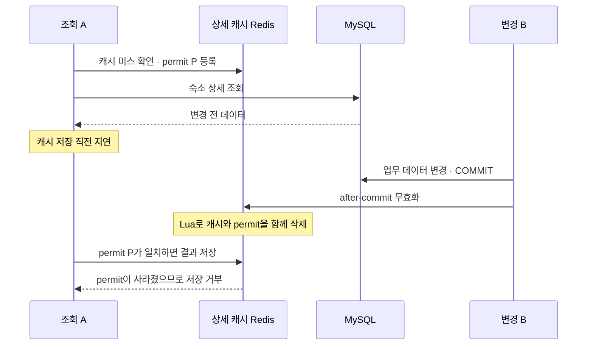
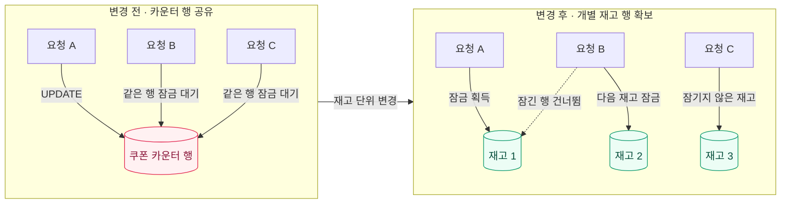
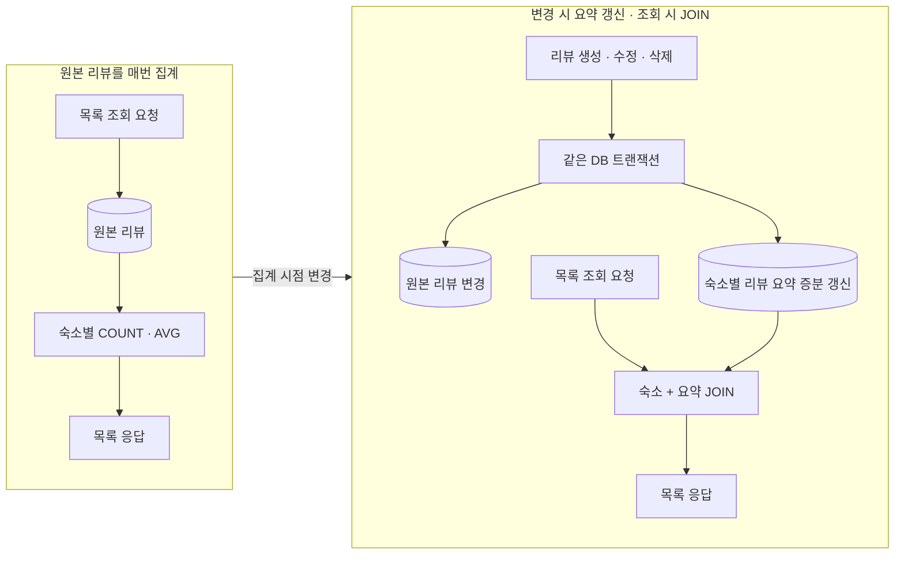
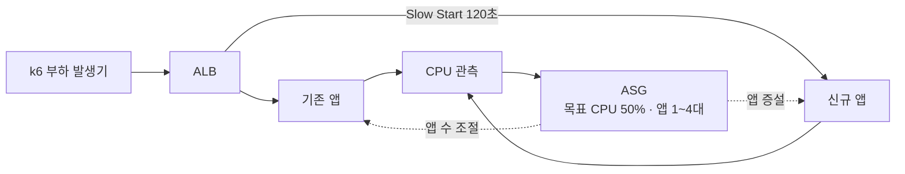

# Airbob

## 프로젝트 소개

숙소 검색·예약·위시리스트·리뷰 기능을 제공하는 숙박 예약 플랫폼입니다.

2025년 6~7월 3인 팀으로 개발했으며, 프로젝트 종료 후에는 개인적으로
학습한 내용을 적용하고 다양한 트래픽·장애 상황을 재현하며
성능 병목과 정합성 문제를 분석하고 개선했습니다.

- **팀 개발:** 숙소 후기·위시리스트·최근 본 숙소 기능 개발
- **개인 고도화:** 숙소 상세 조회 캐시·쿠폰 발급·쿼리 최적화·인프라 개선

Java 21.0.12.1 · Spring Boot · JPA · QueryDSL · MySQL · Redis

개발·빌드에는 **Eclipse Temurin JDK 21.0.12.1+1**을 사용합니다. 터미널의 `JAVA_HOME`, IntelliJ의
Project SDK와 Gradle JVM을 같은 JDK로 맞추고 `java -version`, `./gradlew --version`으로 확인합니다.

Website: [Airbob](https://www.airbob.cloud/)  

체험 계정

- GUEST:
    - 이메일: demo@airbob.test
    - 비밀번호: airbobdemo213
- HOST:
    - 이메일: host@airbob.test
    - 비밀번호: airbobhost213

주요 도시 검색 결과

    
- [코펜하겐](https://www.airbob.cloud/search?destination=Copenhagen)
- [바르셀로나](https://www.airbob.cloud/search?destination=Barcelona)
- [토론토](https://www.airbob.cloud/search?destination=Toronto)

    

    
## 주요 개선 성과 요약
아래는 별도 실험의 결과입니다. 측정 환경·부하·집계 방식은 항목별 상세 문서에 기록했습니다.

| 개선 항목 | 개선 전 → 후 | 측정 조건 |
|---|---|---|
| [숙소 상세 캐시](docs/performance/cache.md) | 처리량 **1,100 → 5,000 RPS** | 앱 1대, 숙소 20개 반복 조회 |
| [캐시 동시 미스 대응](docs/performance/cache.md) | DB 로딩 **300 → 1회** | 앱 2대, 같은 숙소에 300건 버스트 |
| [Redis 장애 시 요청 병합](docs/performance/cache.md) | DB 로딩 **300 → 19회** | 앱 1대, 같은 숙소에 300건 버스트 |
| [쿠폰 발급 경합 완화](docs/performance/coupon.md) | 처리 가능 부하 **125 → 500** RPS | 앱 1대, 각 부하에서 120초씩 3회 |
| [최근 본 숙소 N+1 제거](docs/performance/recently-viewed.md) | SELECT **103 → 3회**, p95 **83.82 → 21.06ms** | 숙소 100개·원본 리뷰 집계 유지·20 RPS |
| [위시리스트 벌크 삭제](docs/performance/bulk-write.md) | DELETE **1,000 → 1회** | 위시리스트에 담긴 숙소 1,000개 삭제 |
| [리뷰 집계 요약 테이블](docs/performance/review-summary.md) | p95 **18.42 → 11.03ms** | 위시리스트 숙소 50개, 20 RPS, 3회 중앙값 |
| [ALB·ASG 자동 확장](docs/performance/asg.md) | p95 **803 → 7ms** | 6,000 RPS·15분, 앱 1대 고정 대비 2→4대 확장, 각 1회 |

최근 본 숙소의 N+1 행은 원본 리뷰 집계를 유지한 비교입니다. 현재 운영 API는 리뷰 요약까지 적용해 유효 숙소 1~100개에서 SELECT 2회를 사용합니다.

DB 로딩은 숙소 상세 데이터를 읽는 로더의 실행 횟수이며, 로딩 한 번에 여러 SQL이 실행될 수 있습니다.

[전체 문서 목차](docs/README.md) · [성능 결과와 실험 이력](docs/performance/README.md) · [부하 테스트 방법](load-test/README.md)

## 목차

- [시스템 아키텍처](#시스템-아키텍처)
- [숙소 상세 캐시](#숙소-상세-캐시)
- [쿠폰 동시 발급](#쿠폰-동시-발급)
- [쿼리 관측과 리뷰 집계](#쿼리-관측과-리뷰-집계)
- [ALB·ASG 자동 확장](#albasg-자동-확장)

## 시스템 아키텍처

### 서비스 구성

### 인프라 구성

애플리케이션 서버는 **c6i.large**(2 vCPU, 4 GiB)를 사용했습니다. CPU 크레딧을 사용하지 않는 인스턴스를 선택해, 장시간 부하에서도 크레딧 소진에 따른 성능 제한 없이 캐시·쿼리 개선과 Scale-Out에 따른 처리량·응답 시간 변화를 비교하고자 했습니다.

> AWS 프리티어 크레딧 소진 이후에는 OCI에서 Docker Compose로 서비스를 운영하고 있습니다.  
> 성능 실험이 필요할 때 이미지의 AWS 환경을 구성해 사용합니다.

### ERD

> 가독성을 위해 이력(history) 테이블은 생략했습니다.

## 기술적 의사결정

### 숙소 상세 캐시

캐시를 적용하면 반복 조회의 DB 비용은 줄어들지만, 캐시가 비어 있을 때 같은 숙소로 요청이 몰리거나, Redis 장애로 요청이 DB에 우회하면 중복 조회가 다시 발생합니다.

| 상황 | 조정 방법 | 적용 범위 |
|---|---|---|
| Redis 정상 · 캐시 미스 | 숙소별 분산 락을 획득한 뒤 캐시 재확인 | 여러 앱 인스턴스의 캐시 로딩 |
| Redis 조회 실패 · 락 획득 실패 | 같은 숙소의 진행 중인 조회 결과를 `CompletableFuture`로 공유 | 같은 JVM 안의 DB 우회 조회 |
| DB 조회 중 데이터 변경 | 조회 시작 시 발급한 permit이 유효할 때만 캐시 저장 | 무효화 이전 조회의 뒤늦은 캐시 쓰기 |

락을 얻은 요청도 캐시를 다시 확인합니다. 기다리는 동안 앞선 요청이 값을 채웠다면 DB 조회를 생략할 수 있기 때문입니다. 락 대기 시간 초과 시에도 캐시를 한 번 더 확인한 뒤 우회 여부를 결정합니다.

Redis를 사용할 수 없는 경로에서는 [같은 JVM 안의 요청을 병합](src/main/java/kr/kro/airbob/domain/accommodation/cache/AccommodationDetailLocalLoadCoordinator.java)합니다. 서로 다른 앱의 조회까지 합칠 수는 없으며, 선행 조회 대기가 설정된 상한을 넘으면 해당 요청은 독립적으로 DB를 조회합니다. 이 경로는 캐시에 결과를 쓰지 않습니다.

#### 캐시를 삭제한 뒤에도 예전 값이 돌아올 수 있다

조회 A가 DB에서 예전 데이터를 읽고 캐시 저장 직전에 멈췄다고 가정합니다. 그사이 변경 B가 DB를 수정하고 캐시를 삭제해도, A가 뒤늦게 예전 값을 저장하면 다음 요청부터 다시 오래된 데이터를 읽게 됩니다.

이를 막기 위해 DB 조회 전에 고유한 쓰기 허가인 `permit`을 Redis에 기록합니다. 무효화는 캐시와 permit을 함께 삭제하고, 조회 결과 저장은 permit 비교와 쓰기를 하나의 Lua 연산으로 수행합니다.

permit 비교와 저장을 별도 요청으로 나누면 그 사이에 무효화가 끼어들 수 있어 [하나의 Lua 연산](src/main/java/kr/kro/airbob/domain/accommodation/cache/AccommodationDetailRedisStore.java)으로 처리합니다. 무효화보다 늦게 끝난 조회가 캐시를 다시 채우지 못하는지는 [경합 테스트](src/test/java/kr/kro/airbob/domain/accommodation/cache/AccommodationDetailCacheInvalidationRaceIntegrationTest.java)로 확인합니다. 이미 시작한 조회에는 이전 데이터가 반환될 수 있지만, 그 결과가 캐시에 남아 후속 요청에 반복 제공되는 것을 막습니다.

### 쿠폰 동시 발급

조건부 UPDATE는 수량을 안전하게 증가시킬 수 있지만, 같은 쿠폰의 모든 요청이 하나의 카운터 행을 수정합니다. 해당 행의 잠금이 커밋까지 유지되므로 동시 요청이 늘수록 같은 지점에 대기가 쌓입니다.

수량만큼 미사용 재고 행을 미리 준비하고, 각 요청이 잠기지 않은 행 하나를 가져가도록 변경했습니다. `SKIP LOCKED`로 이미 잠긴 행을 건너뛰며, 발급 경로에서 공유 카운터를 갱신하지 않습니다.

[발급 트랜잭션](src/main/java/kr/kro/airbob/domain/coupon/service/CouponSkipLockedIssueService.java)에서는 쿠폰 정책을 공유 잠금으로 확인한 뒤, 선택한 재고 행의 DELETE와 `member_coupon` INSERT를 함께 커밋합니다. 회원·쿠폰 유니크 제약을 위반하거나 저장이 실패하면 재고 삭제도 롤백됩니다.

#### 빈 조회와 품절을 구분하기

마지막 재고를 다른 트랜잭션이 잠그고 있다면, `SKIP LOCKED` 조회에는 아무것도 나오지 않을 수 있습니다. 그 트랜잭션이 롤백할 가능성이 있으므로 이 결과만으로 품절을 확정할 수 없습니다.

1. 재고를 확보하지 못한 발급 시도를 롤백합니다.
2. 새 트랜잭션의 스냅샷에서 중복 발급 여부·정책·잔여 재고를 다시 확인합니다.
3. 재고가 없으면 품절(`CP002`), 재고가 남아 있으면 횟수와 시간 예산 안에서 재시도합니다. 한도를 넘기면 재시도 가능한 경합(`CP012`)으로 응답합니다.

마지막 재고를 다른 요청이 잠근 상태, 중복 발급, 저장 실패 시 재고 복구는 [MySQL 동시성 테스트](src/test/java/kr/kro/airbob/domain/coupon/CouponConcurrencyTest.java)에서 확인합니다.

현재 기본값은 대리 키와 `REPEATABLE_READ`입니다. 복합 키 및 `READ_COMMITTED`도 비교했지만 기존 선택을 바꿀 만큼 일관된 이점을 확인하지 못했습니다. 재고 수량에 비례하는 저장 공간과 사전 준비 비용이 필요하며, 발급 시작 후에는 수량 변경이나 재입고를 허용하지 않습니다.

같은 AWS 환경의 앱 1대에서 조건부 UPDATE 125 RPS, 대리 키 RR 500 RPS가 각각 120초씩 3회 기준을 통과했습니다. 성공 p95 중앙값은 각각 57.6ms와 56.9ms였습니다.

### 쿼리 관측과 리뷰 집계

HTTP 요청 단위로 Hibernate SQL 발생 횟수를 집계하고 응답 시간과 함께 관측했습니다. 최근 본 숙소의 주소 접근에 따른 추가 SELECT는 DTO 프로젝션과 JOIN으로, 위시리스트 삭제의 개별 DELETE는 벌크 삭제로 줄였습니다.

리뷰 집계는 다른 종류의 문제였습니다. 이미 여러 숙소의 리뷰를 묶어 한 번에 조회해도, 매 요청마다 원본 리뷰를 읽고 COUNT·AVG를 계산하는 비용이 남았습니다. 이 경우에는 쿼리 횟수와 함께 실행 시간·읽은 행 수를 봐야 했습니다.

요약 테이블에 리뷰 수·평점 합계·평균을 유지하고, [리뷰 변경과 요약 갱신](src/main/java/kr/kro/airbob/domain/review/repository/AccommodationReviewSummaryRepository.java)을 같은 트랜잭션에서 처리합니다. 반복 읽기의 계산은 줄어들지만, 리뷰를 쓸 때 요약 갱신 비용이 추가되고 같은 숙소의 요약 행에서 경합이 생길 수 있습니다.

위시리스트 숙소 50개·20 RPS의 AWS 비교에서 3회 p95 중앙값은 **18.42ms → 11.03ms**였습니다. 최근 본 숙소의 N+1 제거와 리뷰 요약 적용은 각각 따로 측정했습니다. 

요청별 SQL 계측은 Hibernate를 거치는 범위입니다. 직접 JDBC나 백그라운드 작업은 이 지표에 포함되지 않으므로 필요한 실험에서는 MySQL 실행계획과 statement digest를 함께 확인합니다.

### ALB·ASG 자동 확장

AWS 실험 환경에서는 CPU 목표 50%로 앱을 1~4대 자동 확장·축소했습니다. 증설된 앱이 요청을 받기 시작한 직후 CPU와 응답 지연이 높아지는 구간을 관측해, ALB Slow Start 120초로 신규 앱의 요청 비중을 점진적으로 늘렸습니다.

ASG는 필요한 앱 수를 조절하고, Slow Start는 새로 등록된 앱에 요청이 배분되는 속도를 조절합니다.

| 같은 부하 단계의 비교 | CPU 50% 정책 | CPU 50% + Slow Start 120초 |
|---|---:|---:|
| 증가 구간 p95 | 1,400ms | 155ms |
| 증가 구간 완료 RPS | 3,401.3 | 3,499.7 |
| 전체 60분 미시작 요청 | 68,487건 | 0건 |

앱 1대 고정 구성과 최종 구성의 동일한 6,000 RPS·15분 피크 구간을 비교하면 p95는 **803ms → 7ms**, 완료 처리량은 **5,727.3 → 6,000.0 RPS**였습니다. 최종 구성은 해당 구간에 2대에서 4대로 확장했으며, 유입 감소 후에는 다시 1대로 돌아왔습니다.

각 구성은 1회 실행했고, 추가 앱이 준비된 시점과 실제 앱 수에도 차이가 있었습니다. 미시작 요청은 p95에 포함되지 않으므로 응답 시간과 완료 처리량, 앱 수를 함께 비교했습니다. 

