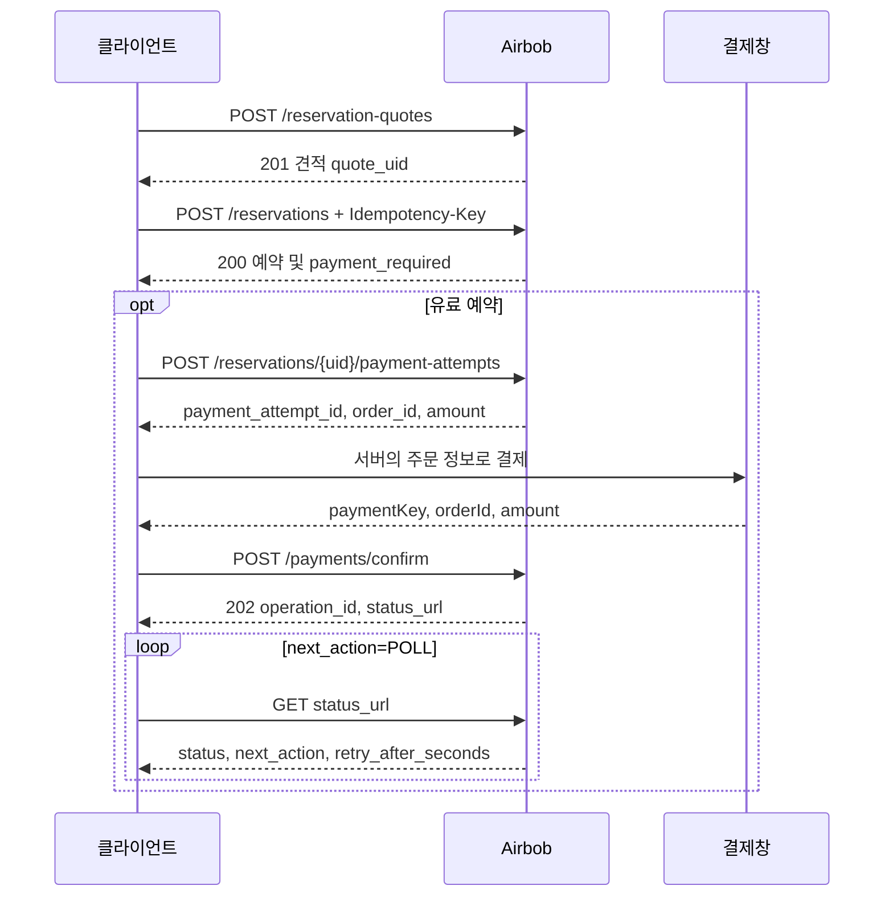

# 예약과 결제 연동

유료 예약은 견적 생성, 체크아웃, 결제 시도 발급, 결제창, 결제 확인 요청, 상태 조회 순서로 진행한다. 체크아웃 응답의 `payment_required`가 false인 0원 예약은 결제 단계로 진입하지 않는다.



그림의 경로 앞에는 `/api/v1`을 붙인다.

## 1 견적 생성

`POST /api/v1/reservation-quotes`

```json
{"accommodation_id":101,"check_in_date":"2027-01-10","check_out_date":"2027-01-12","guest_count":2}
```

숙소 현지 오늘부터 3개월 범위에서 체크인·체크아웃 날짜를 선택한다. 마지막 경계 날짜는 체크아웃일로만 사용할 수 있다. 당일 예약은 숙소 체크인 시각 전까지만 가능하며 인원은 숙소의 최대 수용 인원 이하여야 한다. 예시 날짜는 실제 실행 시 예약 가능한 날짜로 바꾼다.

쿠폰을 적용한다면 보유한 쿠폰의 캠페인 ID를 `coupon_id`로 추가한다. 보유 쿠폰 발급 내역의 숫자 ID가 아니다. 미사용 시 생략하거나 null로 보낸다. 반환된 `data.quote_uid`를 체크아웃에 사용한다. 견적은 가격·할인·숙박 조건의 스냅샷이다. 현재 재고를 조회하지만 잠그거나 확보하지 않으며 쿠폰을 사용 처리하지도 않는다. 견적에는 시간 만료 필드가 없지만, 체크아웃에서 현재 가격·쿠폰·숙소·재고를 다시 검증한다. 데이터 보관 기간과 예약 보유 시간은 별개다. 보관 정책에 따라 삭제된 견적은 404/R017을 받으므로 새 견적이 필요하다.

견적 단계에서도 재고 중복은 409/R002, 날짜 재고 준비 중은 503/R026이다. 쿠폰 미보유는 404/CP006, 이미 사용한 쿠폰은 409/CP007, 현재 적용 불가는 409/CP008이다.

## 2 체크아웃과 멱등성

`POST /api/v1/reservations`

헤더: `Idempotency-Key: checkout-00000001`

```json
{"quote_uid":"00000000-0000-0000-0000-000000000010","request_message":"늦은 체크인 예정입니다."}
```

키는 8~128자의 영문자·숫자·`.`·`_`·`:`·`-` 조합이다. 같은 회원이 같은 키와 같은 요청을 보내면 기존 예약의 **현재 상태**를 반환한다. 최초 응답을 그대로 복사하거나 보유 기한을 연장하지 않는다. `request_message`를 포함한 요청 내용이 달라지면 409/R016이다. 요청 사항은 최대 255자이며 생략과 null은 동일하지만 빈 문자열·앞뒤 공백은 구분한다. 네트워크 단절로 결과를 모를 때에는 키와 요청을 보존해서 재시도한다. 하나의 견적은 한 번만 체크아웃에 연결한다.

유료 예약은 PAYMENT_PENDING으로 생성하고 기본 15분간 재고를 확보한다. 운영 설정에 따라 달라질 수 있으므로 실제 기한은 응답을 따른다. 응답의 `hold_expires_at`, `server_time`, `payment_allowed`를 확인한다. `payment_required=false`인 0원 예약은 이미 CONFIRMED 상태이므로 결제 시도 발급과 결제 확인 요청을 건너뛰고 예약 상세로 진행한다.

| 결과 | 다음 행동 |
|---|---|
| R019 | 조건이나 금액이 바뀌었다. 새 견적을 요청한다. |
| R020 | 다른 요청으로 사용된 견적이다. 기존 예약 상태를 확인한다. |
| R002 | 날짜가 점유되었다. 날짜를 다시 선택한다. |
| R025 | 잠금 경합이다. `Retry-After: 1` 이후 같은 키·요청으로 재시도한다. |
| R026 | 날짜 재고가 준비되지 않았다. 잠시 뒤 다시 확인한다. |

## 3 결제 시도와 확인 요청

결제창을 열기 전에 `POST /api/v1/reservations/{reservationUid}/payment-attempts`를 호출한다. 반환된 `payment_attempt_id`를 보관하고 `order_id`, `amount`, `currency` 등 서버 값을 사용한다. 최초 시도 발급에는 기본 90초 이상의 보유 시간이 필요하다. 이미 발급한 미사용 시도는 보유 만료 전까지 같은 ID로 다시 받을 수 있고, 이때는 90초 미만이어도 가능하다. 재호출은 보유 기한을 연장하지 않는다. `remaining_seconds`는 소수점 이하를 버린 초 단위다.

최초 발급 시간이 부족하거나 보유가 만료되면 409/R022, 0원 예약·사용한 시도·허용되지 않는 상태는 409/R023이다. `payment_allowed=true`도 최초 발급의 최소 잔여 시간을 보장하지 않는다. 무조건 새 토큰을 반복 발급하는 방식으로 재시도하지 않는다. 이 API와 보유 해제 응답은 `Cache-Control: no-store`다.

결제창에서 받은 결과를 사용해 `POST /api/v1/payments/confirm`을 호출한다.

```json
{"payment_key":"example-payment-key","order_id":"00000000-0000-0000-0000-000000000020","amount":10000,"payment_attempt_id":"00000000-0000-0000-0000-000000000030"}
```

202 응답은 처리 접수다. `data.status_url`로 작업 상태를 조회한다. 결제 키나 성공 리다이렉트만으로 예약 완료 화면을 확정하지 않는다. 실제 요청에서는 예시 식별자를 서버와 결제창에서 받은 값으로 대체한다.

## 4 상태 조회와 다음 행동

`GET /api/v1/payment-operations/{operationId}`는 캐시하지 않는다. 응답의 `next_action`을 우선하여 다음 행동을 결정한다.

| status | 의미 |
|---|---|
| PENDING | 접수 또는 재시도 대기 |
| PROCESSING | 처리 중 |
| SUCCEEDED | 결제 확인 또는 취소가 적용됨 |
| FAILED | 최종 거절 |
| REQUIRES_REVIEW | 운영자의 확인이 필요함 |

| next_action | 처리 |
|---|---|
| POLL | `retry_after_seconds`만큼 기다린 뒤 상태를 조회한다. |
| START_NEW_CHECKOUT | 새 견적부터 예약을 진행한다. |
| RETRY_CANCELLATION | 현재 상태를 확인한 뒤 취소를 재요청한다. |
| CONTACT_SUPPORT | `user_message`를 표시하고 고객센터 안내로 연결한다. |
| NONE | 자동 재시도를 종료하고 예약 상세를 확인한다. |

API의 상태 문자열을 그대로 사용한다. DB 내부 작업 상태 이름을 클라이언트에 사용하는 계약으로 옮기지 않는다. `failure_code`와 사용자용 `user_failure_code`는 서로 다른 필드다.

## 5 보유 해제와 예약 취소

결제 대기 예약에서 벗어날 때 `DELETE /api/v1/reservations/{reservationUid}/hold`를 본문 없이 호출한다. 저장된 PAYMENT_PENDING 상태를 EXPIRED로 바꾸고 해당 예약이 소유한 임시 확보와 쿠폰을 해제한다. 시도 ID를 발급받았어도 아직 결제 확인 처리를 시작하지 않았다면 가능하다.

이미 EXPIRED이면 200과 `released_now=false`다. 기한이 지났더라도 아직 PAYMENT_PENDING 상태라면 이번 요청에서 상태를 바꾸므로 `released_now=true`다. PAYMENT_PROCESSING 등 다른 상태는 409/R021이다. 이미 결제된 예약에는 취소 API를 사용한다.

예약 취소는 `POST /api/v1/reservations/{reservationUid}`이다.

```json
{"cancel_reason":"여행 일정 변경"}
```

취소 사유는 필수이며 200자 이하다. 유료 예약은 전액 취소만 지원한다. `cancel_amount`는 생략·null 또는 현재 결제 잔액 전액이다. 0원 예약에서는 생략하거나 null로 보낸다. 새 취소는 체크인 시각 전까지만 가능하다.

유료 예약은 CONFIRMED 또는 CANCELLATION_FAILED에서 새 취소를 접수한다. 이미 취소 중이거나 취소된 예약에 같은 사유·금액으로 요청하면 기존 작업을 반환하고, 내용이 다르면 409/P006이다. 이 재조회는 체크인 시각 이후에도 가능하다. 0원 예약은 즉시 취소되며 취소 후 반복 요청도 성공한다.

응답은 202와 `{"success":true}`이다. 비동기 취소 작업이 있으면 `Location` 헤더가 상태 조회 URL을 제공한다. 0원 예약 취소는 헤더 없이 완료되므로 예약 상세로 결과를 확인한다. 취소 처리 중·실패·수동 확인 상태를 취소 완료로 표시하지 않는다.

관리자의 대사와 미결제 확정 절차는 [결제 운영 안내](../operations/payment-operation-runbook.md)를 따른다.

## 6 예약 조회와 오류 구분

게스트 상세는 `/api/v1/profile/guest/reservations/{reservationUid}`, 호스트 상세는 `/api/v1/profile/host/reservations/{reservationUid}`이다. 경로에는 `reservation_uid`를 사용하며 화면용 `reservation_code`나 숫자 `reservation_id`를 넣지 않는다. 호스트의 권한은 숙소의 현재 소유자를 기준으로 확인한다.

게스트 상세와 체크아웃 재조회는 기한이 지난 결제 대기를 정리 작업 전에도 `status=EXPIRED`, `payment_allowed=false`로 보여 준다. 이때 `hold_expires_at`에는 과거 기한이 남아 있을 수 있다. 호스트 상세는 저장된 상태를 반환하므로 정리 전에는 PAYMENT_PENDING일 수 있다. 호스트 목록에서 제외되는 결제 대기·처리 중 예약도 상세로는 조회할 수 있다.

`check_in_date_time`, `check_out_date_time`은 오프셋 없는 숙소 현지 일시이며 `time_zone_id`와 함께 읽는다. 게스트 상세의 `check_in_time`, `check_out_time`은 `15:00:00`, `11:00:00` 같은 문자열이다. `created_at`, `server_time`, `hold_expires_at`은 UTC다. 결제 기록이 없으면 `payment`는 null이며 과거 회원 데이터의 닉네임·이메일도 null일 수 있다.

`can_write_review`는 숙소가 PUBLISHED이고, 예약이 CONFIRMED 또는 CANCELLATION_FAILED이며, 체크아웃 시각에 도달했고, 같은 숙소에 본인의 게시된 리뷰가 없을 때 true다.

목록 경로는 상세 경로에서 마지막 UID를 뺀 주소다. `cursor`, `size`, `filterType` 쿼리를 받으며 생성 시각·ID 내림차순이다. 기본 20개, 최대 50개이며 필터를 바꾸면 커서를 초기화한다. 쿼리는 `filter_type`이 아닌 `filterType`이다.

| 필터 | 게스트 목록 | 호스트 목록 |
|---|---|---|
| 생략 | 모든 상태 | PAYMENT_PENDING·PAYMENT_PROCESSING 제외 |
| UPCOMING | 만료 전 PAYMENT_PENDING, PAYMENT_PROCESSING, 체크아웃 전의 유효 예약 | 체크아웃 전의 유효 예약 |
| PAST | 체크아웃 시각에 도달했거나 지난 유효 예약 | 동일 |
| CANCELLED | CANCELLED·EXPIRED 및 기한이 지난 PAYMENT_PENDING | 저장된 CANCELLED·EXPIRED |

여기서 유효 예약은 CONFIRMED·CANCELLATION_PENDING·CANCELLATION_FAILED다. 호스트 목록은 모든 필터에서 결제 대기·처리 중을 제외한다. 숙소의 게시 중단·삭제 상태는 기존 예약 조회를 막지 않는다.

| 요청 | 없는 예약·다른 회원의 예약·잘못된 UID |
|---|---|
| 게스트·호스트 상세, 보유 해제, 결제 시도 | 모두 404/R001 |
| 예약 취소 | 없음 404/R001, 다른 게스트 403/P004, UID 해석 실패 400/C001 |

로그인하지 않은 요청은 위 업무 검사 전에 401/M004를 받는다. 유료 결제가 없는 예약을 취소 API로 처리하려 하면 404/P001을 받을 수 있으므로 결제 대기 해제에는 보유 해제 API를 사용한다.
