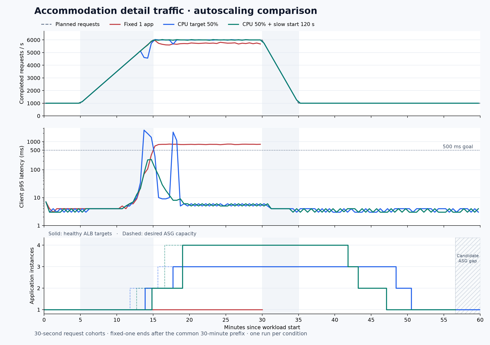

# ALB·ASG 숙소 상세 조회 부하 측정

원본 계측 파일·설정·검증 기록: [측정 당시 보관본](https://github.com/eeoos/airbob/tree/a10b89a1bfdc173f3f327ed4657a1df2db14d2cd/docs/performance/results/asg-aws-2026-10-12).

2026년 10월 12일 AWS 실험 환경에서 앱 1대 고정, CPU 목표 50% 자동 확장, 같은 정책에 ALB slow start 120초를 적용한 구성을 각 1회 측정했다. 아래 수치는 완료된 실제 상세 조회 요청에서 계산했다.

## 핵심 결과

- 같은 **6,000 RPS 예정 부하·15분 피크**에서 앱 1대 고정 대비 최종 구성의 완료 RPS는 **5,727.3 → 6,000.0**, p95는 **803 → 7ms**였다. 시작하지 못한 요청은 p95에서 제외되므로 완료 RPS와 아래 누락 수를 함께 봐야 한다.
- CPU 50% 정책만 적용했을 때는 증가 구간 지연과 요청 누락이 남았다. 신규 앱에 요청을 점진적으로 배분한 후보까지 측정했으며, 전체 기준 충족 여부는 아래 단계별 수치로 판정했다.
- 최종 구성에서 최대 **4대**가 healthy로 확인됐다. 유입이 1,000 RPS로 돌아온 뒤 **13분 10초**에 앱 1대 복귀가 관측됐다. 수동 원복은 측정 종료 후 별도로 수행했다.

## 시나리오와 비교 조건

인기 아티스트의 전국 공연 일정이 공개될 때마다 여러 지역의 숙소를 비교하는 조회가 증가했다가 감소하는 상황을 가정했다. `GET /api/v1/accommodations/{id}`에 실제 숙소 1,000개의 ID를 보냈다. 검색 API·CPU 소모용 API는 사용하지 않았다.

미국 데이터의 5개 지역에서 200개씩 선정했다. 지역별 40개, 총 200개를 인기 숙소로 **가정**해 요청 80%를 배정하고 나머지 800개에 20%를 배정했다. 실제 이용 로그나 실제 공연장 반경을 근거로 한 분포는 아니다. 사용자별 탐색 순서·생각 시간·로그인·예약을 재현한 세션 테스트도 아니다.

| 단계 | 지속 시간 | 예정 요청률 |
|---|---:|---:|
| 평시 | 5분 | 1,000 RPS |
| 증가 | 10분 | 1,000 → 6,000 RPS |
| 피크 | 15분 | 6,000 RPS |
| 감소 | 5분 | 6,000 → 1,000 RPS |
| 회복 관측 | 25분 | 1,000 RPS |

고정 1대는 공통 앞부분인 평시·증가·피크 30분을 측정했다. 두 자동 확장 구성은 축소까지 보기 위해 60분을 측정했다. 서로 길이가 다른 전체 실행의 p95를 전후 지표로 비교하지 않는다. 같은 단계의 p95는 해당 단계 요청 전체에서 직접 계산했으며 버킷 p95의 평균이 아니다.

## 동일 단계의 결과

| 단계 | 구성 | 예정 RPS | 완료 RPS | 클라이언트 p95 | HTTP·본문 실패 |
|---|---|---:|---:|---:|---:|
| 평시 5분 | 앱 1대 고정 | 1,000 | 999.9 | 4ms | 0 |
| 평시 5분 | CPU 50% | 1,000 | 999.9 | 4ms | 0 |
| 평시 5분 | CPU 50% + slow start 120초 | 1,000 | 999.9 | 4ms | 0 |
| 증가 10분 | 앱 1대 고정 | 3,500 | 3,499.6 | 146ms | 0 |
| 증가 10분 | CPU 50% | 3,500 | 3,401.3 | 1,400ms | 0 |
| 증가 10분 | CPU 50% + slow start 120초 | 3,500 | 3,499.7 | 155ms | 0 |
| 피크 15분 | 앱 1대 고정 | 6,000 | 5,727.3 | 803ms | 0 |
| 피크 15분 | CPU 50% | 6,000 | 5,989.5 | 7ms | 0 |
| 피크 15분 | CPU 50% + slow start 120초 | 6,000 | 6,000.0 | 7ms | 0 |

예정 RPS는 도착률 설정값, 완료 RPS는 **그 단계에서 시작해 완료한 요청 수 ÷ 단계 시간**이다. 증가 단계의 예정 RPS는 시작·끝 요청률의 평균이다. p95는 연결·TLS를 포함하는 클라이언트 경과 시간이며 1ms 해상도로 측정했다. 200 응답과 사전 검증한 본문을 함께 확인했다.

| 구성 | 전체 길이 | k6 native dropped_iterations | 30초 p95 > 500ms 버킷 | 최악의 30초 p95 | 발생기 CPU 최대(약 10초 표본) |
|---|---:|---:|---:|---:|---:|
| 앱 1대 고정 | 30분 | 245,410 | 30개 | 821ms | 72.5% |
| CPU 50% | 60분 | 68,487 | 5개 | 2,583ms | 74.6% |
| CPU 50% + slow start 120초 | 60분 | 0 | 0개 | 231ms | 71.5% |

`dropped_iterations`는 4,000 VU 상한 등으로 **시작하지 못한 요청**이며 HTTP 실패가 아니다. 위 누적값은 각 실행 전체 길이에 해당한다. 시작되지 않은 요청은 p95에 들어가지 않으므로 p95와 누락을 함께 해석해야 한다. `summary.json`의 단계별 `plannedMinusStartedEstimate`는 경계 스케줄링의 작은 오차를 포함하는 예정-시작 차이이며 native dropped의 단계별 계측값이 아니다.

사전에 정한 기준은 단계별 p95 ≤ 500ms, HTTP·본문 실패율 < 0.1%, 예정 요청의 99% 이상 시작, 실행 전체 native dropped 0건이다. 전체 기준 충족 여부: **고정 1대 미충족, CPU 50% 미충족, slow start 120초 충족**. 짧은 지연 구간은 별도로 위 30초 버킷에 남겼다.

## 확장과 축소

| 구성 | 최대 healthy 앱 | 유입 증가 시작 → 첫 추가 앱 healthy | 1,000 RPS 복귀 → 1대 복귀 | 60분 ASG 멤버·분 |
|---|---:|---:|---:|---:|
| CPU 50% | 3대 | 8분 54초 | 16분 34초 | 134.0 |
| CPU 50% + slow start 120초 | 4대 | 9분 50초 | 13분 10초 | 관측 공백으로 제외 |

1대 복귀는 desired·ASG 멤버·InService·healthy가 모두 1이고 draining 대상이 없는 최초 관측이다. 정상 연결 시 약 21초 간격으로 관측했으므로 초 단위 숫자를 정확한 AWS 내부 전환 시간으로 해석하지 않는다. ASG 멤버·분은 Pending 등도 포함한 멤버 수의 근사 적분으로 실제 청구 비용이 아니다. 1~4대 범위를 설정했지만 위 표에 실제 도달한 앱 수만 기록했다.

최종 후보는 자동으로 1대로 돌아온 뒤, 로컬 AWS 관리 연결이 끊기면서 **측정 끝부분 약 206초의 ASG 관측 공백**이 생겼다. 요청 발생과 AWS 내부의 지표 수집은 계속됐으며 최종 k6 원본의 60분 완료·10,349,960건·시작/완료 일치를 확인했다. 이 공백을 임의의 앱 수로 채우지 않았고 후보의 멤버·분 총합은 제외했다. 그래프의 앱 수 패널에도 공백을 표시했다. 확장과 1대 복귀 시점은 공백 이전에 실제로 관측한 값이다.

## 신규 앱에 요청을 보내는 방식

CPU 50% 실행의 피크 p95는 803 → 7ms로 개선됐지만, 증가 구간의 p95는 146 → 1,400ms로 악화됐다. 증가 구간의 예정 요청 시작률은 97.18%였으며 전체 기준은 충족하지 못했다.

신규 앱이 요청을 받기 시작한 직후 CPU가 약 99%에 도달하며 클라이언트 서버 응답 대기가 늘었다. 중간 HTTP 표본의 서버 응답 대기 최댓값은 약 7.2초였고, 연결·TLS 시간의 최댓값은 각각 약 46ms·11ms였다. CPU 50% 증가 구간에서 발생기 CPU의 약 10초 표본 최댓값은 68.7%였다. 이 관측은 신규 앱의 초기 처리 부담을 의심하게 하지만, 호스트 평균 CPU만으로 발생기의 모든 병목을 배제하지는 않는다. 관측된 Hikari 대기는 0이었고 공유 Redis CPU는 낮았지만, 이 정보만으로 모든 DB·네트워크 병목을 배제하거나 JIT를 단독 원인으로 확정하지 않는다.

이에 다음 실행은 **CPU 목표·ASG warmup·이미지·부하를 유지하고 ALB slow start만 0 → 120초로 변경**했다. 이는 ALB의 신규 대상 트래픽 배분 효과를 비교한 것이며 CPU 목표값이나 요청 수 정책의 최적화 실험은 아니다.

slow start 적용 실행의 증가 구간은 완료 3,499.7 RPS·p95 155ms였다. 적용 전의 3,401.3 RPS·p95 1,400ms와 함께 비교해야 한다. 전체 요청 누락은 68,487 → 0건이었다. 최대 healthy 앱은 3 → 4대로 달랐다. 최종 후보의 마지막 ASG 관측 공백 때문에 멤버·분 총합은 비교에서 제외했다. 각 구성 1회 실행이므로 차이 전부를 slow start의 효과로 단정하거나 비용 최적화라고 주장하지 않는다.

첫 추가 앱의 healthy 시점도 증가 시작 후 8분 54초 → 9분 50초로 달랐다. 따라서 증가 구간 p95 차이에는 신규 앱의 초기 지연이 증가·피크 단계 경계에 걸리는 차이도 포함된다. 이 수치만으로 slow start의 효과를 단정하지 않고, 같은 60분 실행의 30초 구간 p95 최댓값 **2,583 → 231ms**, p95가 500ms를 넘은 버킷 **5 → 0개**, 미시작 요청 **68,487 → 0건**을 함께 비교한다.

고정 1대의 피크 구간 앱 CPU 표본 평균은 98.8%, RDS CPU는 4.1%, Redis CPU는 논리 CPU 1개 기준 6.6%였다. 이 실행에서는 앱 CPU가 포화된 양상이 관측됐다. 자원 수치는 Prometheus 15초 표본과 해당 구간 안에 완전히 포함된 CloudWatch 1분 버킷의 통계이며, 모든 순간의 병목을 증명하는 값은 아니다. 구성·단계별 자원 표본 요약은 `summary.json`에 보존했다.

ASG warmup 180초는 InService 이후 확장 판단에 반영되는 지표의 준비 구간이다. ALB slow start 120초는 대상이 healthy가 된 뒤 요청 비중을 점진적으로 늘린다. 서로 다른 기능이다. [AWS ASG warmup 문서](https://docs.aws.amazon.com/autoscaling/ec2/userguide/ec2-auto-scaling-default-instance-warmup.html), [AWS ALB slow start 문서](https://docs.aws.amazon.com/elasticloadbalancing/latest/application/edit-target-group-attributes.html#slow-start-mode).

## 환경과 적용 범위

- 서울 리전, 앱 c6i.large · CPU 2개 · 컨테이너 3GiB · JVM 힙 1,536MiB. 부하 발생기는 별도 c6i.xlarge다. RDS db.t3.small/MySQL 8.4.11, Redis t3.small을 사용했다.
- 응답 시간은 같은 AWS 실험 VPC의 부하 발생기에서 HTTPS API를 호출해 측정했다. 실제 사용자 위치의 인터넷 지연·브라우저 렌더링·이미지 다운로드를 포함하는 화면 로딩 시간은 아니다.
- 같은 digest 고정 이미지와 V30 DB, Hikari 최대/최소 10개·read-only·REPEATABLE_READ를 사용했다. 상세 캐시는 모든 구성에서 동일하게 켰다(TTL 10분, jitter 2분). 캐시 개선 전후 비교가 아니다.
- `aws,traffic-benchmark` 프로필에서 스케줄러·Kafka 리스너·예약 재고 시드·외부 쓰기 연동을 껐다. 기존 업무 데이터를 변경하지 않았다. 일반 운영의 동시 쓰기 부하까지 검증한 결과가 아니다.
- CPU target tracking 50%, min 1/max 4, ASG warmup 180초, health grace 900초. 정책 생성 시 AWS가 만든 high alarm은 1분 3개 구간, low alarm은 1분 15개 구간으로 확인했다. 관리형 alarm을 직접 수정하지 않았다.
- ALB round robin, stickiness off, deregistration delay 30초. 실험 전 살아 있던 ASG는 1/1/1이고 확장 정책이 없었다. CPU 50%는 이번 비교에 명시적으로 설정한 값이며 AWS가 자동 제공한 기본 정책이라는 뜻이 아니다.
- 실행 중 앱은 V30 호환 이미지였으나 기존 Launch Template 2의 부팅 설정은 과거 이미지를 참조했다. 자동 생성되는 앱도 같은 V30 이미지·설정으로 실행되도록 임시 Launch Template 3을 사용하고 신규 앱의 일치를 검증했다. 이번 결과는 이 보고서에 기록한 측정 구성의 검증이다. 과거 콘솔 설정 전체를 그대로 검증한 결과로 해석하지 않으며, 운영 재사용 전 기존 Launch Template의 부팅 설정 정합성을 정리해야 한다.
- k6 1.5.0의 open arrival-rate 모델, VU 사전 할당/상한 4,000, 요청 timeout 8초. VU 4,000을 실제 동시 사용자 4,000명으로 환산하지 않는다.
- 인증서 검증을 유지한 HTTPS로 소유한 실험 ALB에만 연결했다. k6 전용 DNS namespace를 사용했고 호스트 DNS/hosts 해시 불변과 실제 연결 IP를 검증했다. 공개 DNS와 OCI는 변경하지 않았다.
- 앱은 단일 AZ다. AZ 장애 대응·최대 지속 처리량·실제 운영 분포·반복 측정의 통계적 안정성은 이번 결과로 주장하지 않는다. 최초 앱 1대의 scale-in protection을 유지했으며 unhealthy replacement는 활성 상태였다.

## 원본과 재현 근거

- [summary.json](https://github.com/eeoos/airbob/blob/a10b89a1bfdc173f3f327ed4657a1df2db14d2cd/docs/performance/results/asg-aws-2026-10-12/summary.json): 단계별 수치·30초 버킷·정확한 시각·수집 무결성·실험 전 정한 기준.
- [dataset-manifest.json](https://github.com/eeoos/airbob/blob/a10b89a1bfdc173f3f327ed4657a1df2db14d2cd/docs/performance/results/asg-aws-2026-10-12/dataset-manifest.json), [environment.json](https://github.com/eeoos/airbob/blob/a10b89a1bfdc173f3f327ed4657a1df2db14d2cd/docs/performance/results/asg-aws-2026-10-12/environment.json): 입력 ID·분포·이미지 digest·환경.
- [original-configuration.json](https://github.com/eeoos/airbob/blob/a10b89a1bfdc173f3f327ed4657a1df2db14d2cd/docs/performance/results/asg-aws-2026-10-12/original-configuration.json): 실험 시작 시 ASG와 Launch Template의 비밀값을 제외한 설정 요약.
- `raw-results.json.gz`: 세 실행의 k6 원본 요약, 호스트 표본, CloudWatch, Prometheus, ASG 활동·설정·관측을 파일명별 JSON으로 저장했다.
- 최종 후보의 결과 회수는 종료 보호 절차의 원복 이후 재개했다. 따라서 후보의 마지막 정책 조회는 비어 있다. 실험 중 정책은 별도로 저장한 초기 정책·alarm 설정과 측정 시간 안의 ASG 활동 기록으로 확인한다.
- `harness-sources.json.gz`: 실제 사용한 부하 스크립트·수집기·분석기·설정. 실험 ID와 호스트 경로가 고정된 증거용 원본이다. 재실행 시 별도 승인 기한·실험 소유권·대상·응답 fixture를 새로 준비해야 한다.
- 최종 k6 실행의 시작/완료 수, latency 수, phase·bucket 합계, 실패 집계가 모두 일치했다. 동일 fixture와 부하 스크립트 해시를 세 실행에서 확인했다. 본문 원본·환경 비밀값·복구 키는 보고서에 포함하지 않았다.
- CPU 50% 신규 앱 증거의 초기 `heapOptions` 필드는 실제로 `JAVA_TOOL_OPTIONS`를 읽은 명명 오류여서 `javaToolOptions`로 정정했다. 원본과 정정 내역·해시를 함께 보존했다. 해당 실행의 힙 설정 근거는 고정된 부팅 구성과 사전 부팅 검증이며, 최종 후보의 신규 앱 3대에서는 `JAVA_OPTS`도 직접 확인했다.
- 탐색 단계의 direct-IP/TCP-forwarder 측정, DNS namespace 확인 오류로 중단한 실행, 수동 확장 검증은 위 본 비교 통계에 섞지 않았다. 본 비교는 최종 검증한 동일 부하 경로를 사용했다.

## 종료 상태

부하 발생을 종료하고 기존 앱의 이미지·환경을 원복했다. 앱 1대가 정상 상태이고 ASG는 기존 1/1/1·정책 0개로 돌아왔다. 임시 시작 템플릿과 확장 정책을 제거하고 ALB slow start도 원래의 0초로 되돌렸다. 추가로 생성된 앱 6대는 종료 상태로 확인했다. 이는 실험 변경의 원복이며 기존 AWS 랩 전체를 삭제했다는 의미는 아니다.

원복 검증은 [restore-proof.json](https://github.com/eeoos/airbob/blob/a10b89a1bfdc173f3f327ed4657a1df2db14d2cd/docs/performance/results/asg-aws-2026-10-12/restore-proof.json), 관리 연결 중단과 결과 회수 경위는 [collection-note.json](https://github.com/eeoos/airbob/blob/a10b89a1bfdc173f3f327ed4657a1df2db14d2cd/docs/performance/results/asg-aws-2026-10-12/collection-note.json)에 기록했다. 요청 지표는 정상 종료한 전체 실행의 원본으로 검증했고, ASG 관측 공백은 별도로 공개했다. 이번 보고서의 수치는 각 구성 1회 실행 결과다.

이력서에 사용할 간결한 문구는 [resume.md](https://github.com/eeoos/airbob/blob/a10b89a1bfdc173f3f327ed4657a1df2db14d2cd/docs/performance/results/asg-aws-2026-10-12/resume.md)에 정리했다.
